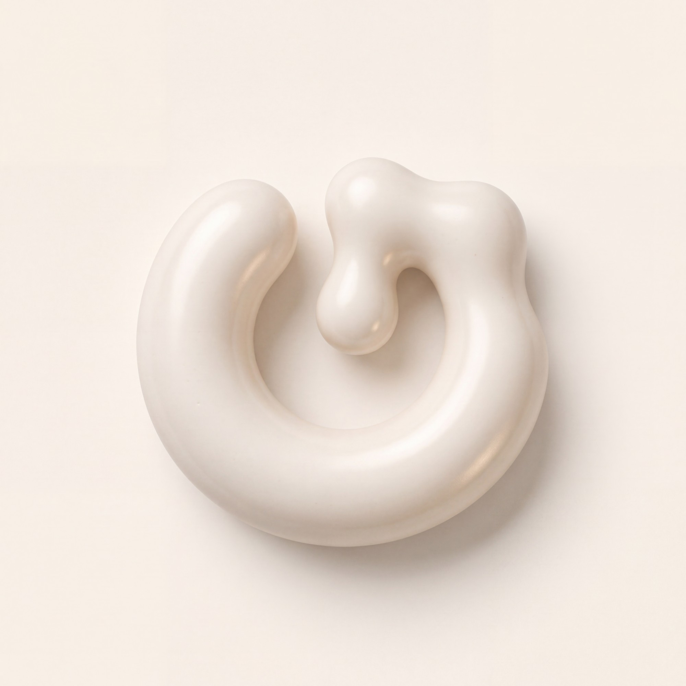

# SoundGOD (סטודיו סאונד)

<p align="center"></p>

ניקוי רעש והד והגברה של הקלטות, מקומי לגמרי: הרצאה חלשה ורחוקה, או סרטון שלך שרוצים שיישמע כמו מיקרופון איכותי. שום דבר לא עולה לרשת. English: `README.md`.

```
שלב 1  ניקוי   Nemotron RE-USE (NVIDIA, על MLX/Metal)   מסיר רעש והד, לא ממציא מילים
שלב 2  ליטוש   ffmpeg                                    שער, חום, נוכחות, דחיסה, עוצמה סופית
```

מנוע אחד, שלוש כניסות: **ממשק אתר מקומי**, **סקיל ל-Claude Code** (`studio-audio`), ו**שורת פקודה**. התוצאה נשמרת ליד המקור כ-`שם - מוגבר ב-AI.סיומת`, והמקור לא משתנה.

**המודלים כלולים** בתיקייה `models/nemotron-re-use/` (38MB). שום דבר לא יורד בזמן ריצה.

## דרישות
Mac עם Apple silicon, macOS 14+, ו-`brew install ffmpeg uv`.

## התחלה מהירה (קובץ zip מ-Releases)
1. מורידים את `SoundGOD-<גרסה>-macos-arm64.zip` ומפרקים.
2. פעם אחת בטרמינל: `xattr -dr com.apple.quarantine /נתיב/אל/SoundGOD-*` (macOS חוסם כלים שהורדו).
3. לחיצה כפולה על `start.command`. נפתח דפדפן עם הממשק.
   לאייקון של אפליקציה אמיתית (Dock, Spotlight, Launchpad): `./scripts/make-app.sh` בונה את `סטודיו סאונד.app` ב-`~/Applications`. היא מרימה את השרת המקומי כשפותחים אותה, וסוגרת אותו אחרי 15 דקות בלי שימוש. אם מזיזים את תיקיית הפרויקט, מריצים את הסקריפט שוב.
4. לסקיל של Claude Code: `./scripts/install-skill.sh`

## מ-git clone
בריפו יש קוד ומשקלים, אבל לא הכלי המקומפל (`bin/`):
```
./scripts/build-cli.sh     # בונה את כלי ה-MLX בגרסה נעוצה (צריך Xcode, וירד Metal Toolchain של כ-840MB בפעם הראשונה)
./start.command
```
`./scripts/package.sh` בונה את קובץ ה-zip לשחרור.

## שלושה מנועים
- **ניקוי (Nemotron RE-USE):** מסיר רעש והד, כלול בפרויקט.
- **שחזור גנרטיבי (Sidon):** משחזר את הקול בצליל נקי ורחב. פריסט `studio` משתמש בו. בהפעלה הראשונה יורדים אוטומטית כ-1GB משקלים וסביבת PyTorch, והם לא נכללים ב-git או ב-zip. רץ על המעבד, כ-20 שניות לדקה.
- **ליטוש (ffmpeg):** EQ, שער, דחיסה והתאמת עוצמה.

אפשר לכבות כל מנוע. בבדיקה על קטע עברי ברור, התמלול של Sidon תאם למקור, אבל על הקלטה חלשה ומהדהדת הוא לא נבדק, ולכן הוא כבוי בפריסט `rescue`.

## הערכת זמן ומנועים
אחרי שבוחרים קובץ, הממשק מציג כמה זמן ייקח העיבוד המלא (והתצוגה המקדימה) לפי ההגדרות, ולכל הגדרה מופיע כמה זמן היא מוסיפה. `--hop 1.0` (בלי חפיפה בין חלקים) מחצה את זמן המודל. בקטע תקין שבדקנו ההבדל בתוצאה היה כ-‎-23dB, אבל לא נבדק על הרצאה עם הד. שני מתגים תחת "מנועי עיבוד" מדלגים על שלב שלם: מודל ה-AI (החלק הכבד, רוב הזמן) או שרשרת הליטוש הקלאסית. ב-CLI: `--no-clean`, `--no-polish`. המספרים מגיעים מ-`SPEED` ב-`engine/enhance.py`, נמדדו על M3 Pro, והם הערכה.

## פריסטים
| | למה | ערכים עיקריים |
|---|---|---|
| `rescue` | הקלטה חלשה, רועשת, עם הד | קצב 16k, ניקוי 100%, ‎-16 LUFS |
| `studio` | הקלטה שלך במצב טוב | ניקוי 90%, חום ונוכחות +1.5 |
| `natural` | להישאר קרוב למקור | ניקוי 60%, ‎-18 LUFS |

## מה למדנו
- מודלים שרק מנקים רעש משאירים את ההד.
- מודל גנרטיבי ממציא מילים בהקלטה חלשה; לכן לא משתמשים בו. Nemotron RE-USE מסיר הד ושומר על התוכן.
- תמיד מקשיבים לתוצאה. המדדים הם רמזים בלבד.

## רישיונות
קוד הפרויקט: MIT. המודל של NVIDIA: OpenMDW-1.1 (הרישיון מצורף ליד המשקלים). כלי ה-MLX: MIT. פרטים ב-`NOTICE.md`.
